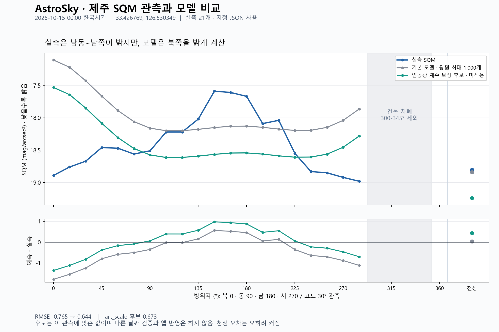

# 제주 SQM 관측 · 2026-10-15 00:00 한국시간

위치: 위도 33.426769, 경도 126.530349. 방위각은 사용자가 확인한 북쪽 0°·동쪽 90° 기준이다.
원본 25개는 [raw/sqm_observations.csv](raw/sqm_observations.csv), API 전체 원본은 [raw/weather_cache_33.4268_126.5303.json.gz](raw/weather_cache_33.4268_126.5303.json.gz)에 있다.
API 압축 파일을 풀면 업로드 전 JSON과 동일한 bytes가 나온다. [원본 메타데이터와 해시](raw/metadata.json).

1. [001_all_25](runs/001_all_25/): 원본 전체를 사용한 최초 분석. 보존용이며 최신 품질 기준은 아니다.
2. [002_unobstructed_21](runs/002_unobstructed_21/): 건물에 가린 300°·315°·330°·345°를 제외한 보정·방향 구간 검증.
3. [003_directional_rmse](runs/003_directional_rmse/): 같은 21개 관측을 현재 평가 코드로 재계산하고 기본 모델·기존 후보의 방위각·고도별 RMSE를 저장한 최신 실행.

제외된 관측값은 원본에서 삭제하지 않았다. [관측별 품질 표시](selections/v002_building_obstruction.csv).

보정 후보는 앱에 적용하지 않았다. 원본·선택·실행·모델 스냅샷의 전체 구조와 재현 방법은 [연구 기록 안내](../../README.md)를 따른다.
