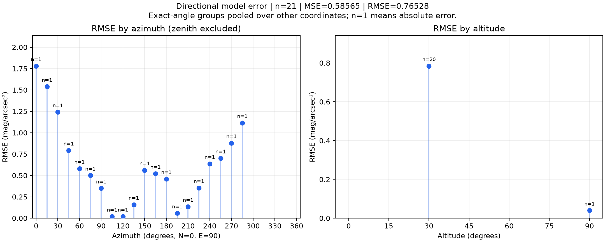
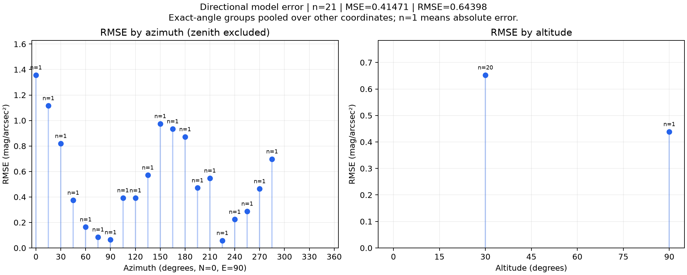

# 방위각·고도별 RMSE · 2026-10-21 실행

관측 시각은 **2026-10-15 00:00 KST**(2026-10-14 15:00 UTC), 위치는 33.426769°N, 126.530349°E다.
원본 25개를 유지하고, 사용자가 건물 차폐로 지정한 고도 30°·방위각 300°/315°/330°/345° 네 개를 제외한 `v002_unobstructed_21.csv`의 21개를 사용했다.

| 평가 | MSE | RMSE | MAE | 평균 오차 |
| --- | ---: | ---: | ---: | ---: |
| 현재 기본 모델 | 0.58565 | 0.76528 | 0.59245 | -0.40840 |
| 기존 보정 후보 (art_scale=0.6732156660053734) | 0.41471 | 0.64398 | 0.53846 | +0.00605 |

오차는 **예측 SQM − 실측 SQM**이다. RMSE·MAE·평균 오차의 단위는 mag/arcsec², MSE는 그 제곱이다.
각 폴더의 `metrics.json`은 반올림 전 값, `evaluation.csv`는 개별 예측과 고도·방위각을 담는다.

## 기본 모델



- 방위각별: 고도 30°의 20개 관측. 천정은 방위각이 의미 없으므로 제외했다. 각 방향이 한 번씩 측정되어 여기서는 RMSE가 절대 오차와 같다.
- 고도별: 30°의 20개를 합친 RMSE와 90° 천정 1개의 오차. 관측하지 않은 고도나 건물에 가린 방향은 보간하지 않았다.
- 같은 각도에서 여러 관측이 있으면 각 오차의 제곱을 모두 평균한 뒤 제곱근을 계산한다. 다른 고도·방위각·시각·위치의 표본이 같은 각도 그룹에 합쳐질 수 있으며 각 점의 `n`이 표본 수다.

## 기존 보정 후보의 같은 자료 재평가



`candidate_params.json`은 실행 002에서 이미 맞춘 계수다. 이번에 새로 학습하지 않았다.
이 자료에 맞춘 후보의 낮은 전체 오차는 독립 검증 성능이 아니다. 실행 002의 방향 구간 검증 RMSE는 0.77326으로 기본 0.76528보다 개선되지 않았으며 천정 오차도 커졌다. 후보를 앱에 적용하지 않는다.

## 검증 방식

1. `evaluator.py`: 현재 `calculator.py`의 고정 계수로 각 방향을 계산하고 실측과 비교한다. MSE=mean(error²), RMSE=sqrt(MSE). 이번 실행이 사용한 방식이다.
2. `kfold_evaluator.py`: 날짜 또는 날짜·시간 그룹 하나를 남기고 다른 그룹으로 계수를 보정한 뒤 남겨둔 그룹을 평가한다. 최소 두 그룹이 필요하다. 출력하는 평균 fold RMSE는 그룹별 동일 가중 평균이다.
3. 실행 002의 60° 방향 구간 및 천정 holdout: 같은 시각의 방향 의존성을 살펴보는 진단이다. 다른 날짜·위치에 대한 검증으로 해석하지 않는다. 이번 실행에서 다시 학습하거나 교차 검증하지 않았다.

관측이 한 시각·한 장소이므로 다른 밤의 일반화 성능은 알 수 없다. API 원본이 관측 이후 생성되어 실시간 예보 검증도 아니다.

## 재현

저장소 루트에서 연구 의존성을 설치한 뒤 실행한다. `--h5`, `--dem`에는 `run.json`에 보존한 SHA-256과 일치하는 로컬 파일을 지정한다. 최대 광원 1,000개, 반경 30km, 누적 광량 0.99, 최소 광원 50개다.

```powershell
python backend/tools/sky_brightness/scripts/evaluator.py --csv backend/tools/sky_brightness/research/datasets/2026-10-15_0000_KST_jeju/inputs/v002_unobstructed_21.csv --weather-cache backend/tools/sky_brightness/research/datasets/2026-10-15_0000_KST_jeju/inputs/api_snapshot_2026-10-14_1500_UTC.json --h5 <H5파일> --dem <DEM파일> --max-pixels 1000 --output-dir <새기본결과폴더>
```

기존 후보는 같은 명령에 `--params backend/tools/sky_brightness/research/datasets/2026-10-15_0000_KST_jeju/runs/003_directional_rmse/candidate_params.json`을 추가하고 별도 출력 폴더를 지정한다.
전체 원본은 데이터 세트의 `raw/`, 제외 기준은 `selections/v002_building_obstruction.json`에 그대로 보존되어 있다.
