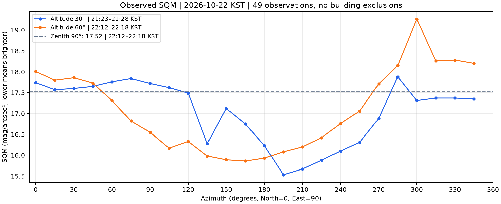
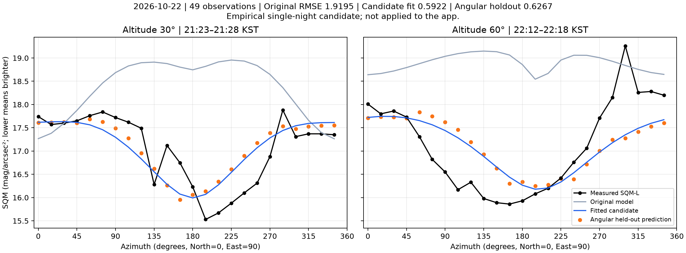
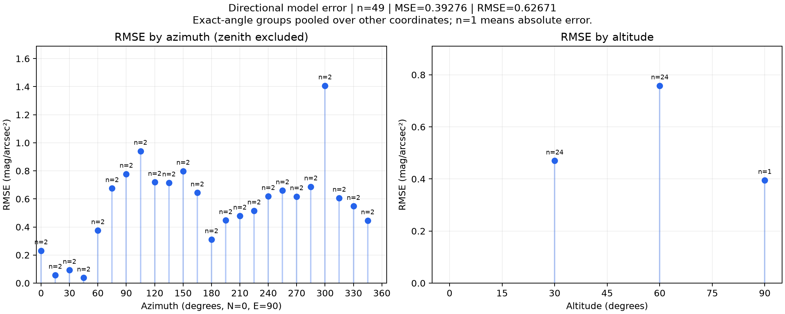

# 제주 SQM-L 관측 · 2026-10-22

관측 위치는 **33.426769°N, 126.530349°E**, 시각은 한국시간(KST)이다. 방위각은 북쪽 0° → 동쪽 90° 기준이다.
사용자는 측정 장비를 **SQM-L로 고정**하고 앞으로 바꾸지 않는다고 확인했다.

| 관측 | 시간 범위(KST) | 개수 |
| --- | --- | ---: |
| 고도 30°, 방위각 0°~345° (15° 간격) | 21:23~21:28 | 24 |
| 고도 60°, 방위각 0°~345° (15° 간격) | 22:12~22:18 | 24 |
| 고도 90° 천정 | 22:12~22:18 | 1 |

**건물 차폐가 없으므로 49개 전부 포함**했다. 300°~345°도 제외하지 않았다. 60°·300°의 SQM 19.26도 원본대로 유지했다.
이전 10월 15일 KST(원본 API 날짜는 10월 14일 UTC) 자료는 사용자의 요청에 따라 이번 보정·검증에서 제외했다.
이전 파일과 결과는 보관용이며 현재 학습 대상이 아니다.

## 원본과 시각

- [원본 실측 CSV](raw/sqm_observations.csv): 사용자가 보낸 모든 수치와 시간 범위를 보존한다.
- [원본 메타데이터](raw/metadata.json), [선택 기준](selections/v001_all_49.json).
- [모델 입력](inputs/v001_all_49.csv): 고도는 `zen = 90 - altitude`로 변환한다.
- 방향마다 정확한 측정 시각은 제공되지 않았다. 구간 중간을 분 단위로 내림한 **21:25 / 22:15**를 대표 시각으로 사용했으며, 실제 측정 시각이라고 가정하지 않는다. 시작·종료 시각도 별도로 보존하고 민감도를 계산했다.
- 고도 30°와 60°는 약 50분 차이가 있어 고도 효과와 시간에 따른 기상 변화를 완전히 분리할 수 없다.



## API는 3시간 간격

현재 AstroSky의 무료 3시간 구성과 같은 패키지를 **한 번씩** 요청했다.
응답의 시간 배열을 직접 확인한 결과 모두 **3시간 간격**, 한국시간 축(`utc_timeoffset=9`), 89개 시점(10월 18일 00:00~10월 29일 00:00)이었다.

| 자료 | 패키지 | 실제 블록 | 차감 헤더 |
| --- | --- | --- | ---: |
| AOD | airquality-3h | data_3h | 8,000 |
| 구름량 | clouds-3h | data_3h | 8,000 |
| 운저 압력 | air-3h | data_3h | 8,000 |

총 **24,000 크레딧**이다. 시상·달 위치를 이 구성에서 받았다고 가정하지 않았다.
기존 `calculator.py`는 시상 값을 밝기 계산에 사용하지 않는다. 이번 연구의 달 위치·위상각은 [Astronomy Engine의 공개 계산](https://github.com/cosinekitty/astronomy/blob/master/source/python/README.md)으로 구했다. 앱이 사용하는 Stellarium과 같은 엔진이라고 표현하지 않는다.

완전한 패키지 응답은 [기상 원본 JSON](raw/weather_cache_33.4268_126.5303_2026-10-22.json)에 있다. 자격 증명만 제거했고 필드·시간·예보값을 줄이지 않았다.
키는 파일이나 커밋에 저장하지 않았다. [조회 기록](raw/weather_cache_33.4268_126.5303_2026-10-22.receipt.json)에 수신 시각·패키지·실제 차감 헤더가 있다.

두 대표 시각은 모두 **21:00~다음 날 00:00** 사이를 보간한다. 21:25는 다음 시점 가중치 25/180, 22:15는 75/180이다.
보간으로 얻은 값이 새 1시간 또는 분 단위 관측이 되는 것은 아니다. AOD는 약 0.13694 / 0.15083, 구름량은 68.4167% / 69.25%, 운저는 약 0.799 / 0.802km다.

지난번 JSON의 시간 간격은 1시간이지만 시상·대기질·대기는 10월 22일 **09:00 KST**에 끝나므로 이번 입력으로 사용하지 않았다.
[시간 간격·범위 대조](inputs/available_api_coverage.json).

## 보정 결과

모든 결과는 같은 49개, 최대 광원 1,000개·반경 30km·같은 H5/DEM·새 API로 비교했다. 오차는 예측 SQM − 실측 SQM이다.

| 방법 | 전체 MSE | 전체 RMSE | 방향 구간 검증 RMSE |
| --- | ---: | ---: | ---: |
| 현재 기본 모델 | 3.68461 | 1.91953 | 1.91953 |
| 기존 인공광·달 투과 계수만 보정 | 2.65711 | 1.63006 | 1.63006 |
| 기존 산란 계수 범위 내 보정(g, art_scale, ms_a) | 1.37956 | 1.17455 | 1.24779 |
| 새 경험적 구름·달빛 산란 후보 | 0.35074 | 0.59224 | 0.62671 |

1. [001_three_hour_calibration](runs/001_three_hour_calibration/): 기존 인공광·달 투과 계수 범위만 사용했다. 계수가 경계에 걸리고 큰 잔차가 남았다.
2. [002_scattering_calibration](runs/002_scattering_calibration/): 기존 산란 계수 후보와 새 경험적 구름·달빛 후보를 비교했다. 이전 실행도 유지한다.





## 후보의 의미와 한계

새 후보는 현재 물리 모델에서 구한 달빛 항에 `1 + moon_cloud_gain * cloud_effect_fraction`을 곱한다. `cloud_effect_fraction`은 현재 모델과 같은 구름 효과량(운저가 모델 범위 내이면 운량의 제곱)이다.
최적 후보는 `g=0.5`, `art_scale=0.05`, `moon_cloud_gain=118.24386924943558`이다.

**이 계수는 물리적으로 확인된 구름 증폭률이 아니다.** 이 밤의 좁은 운량 범위에서는 달빛의 절대 밝기 오차·구름 영향·장비 응답을 분리할 수 없다. g와 인공광 계수도 탐색 하한에 걸렸다.
SQM-L의 실제 각도 응답과 달의 직접 유입은 아직 합성하지 않았다. 그 영향을 구름 산란이라고 단정하거나, 이 한 밤의 수치를 다른 밤에 그대로 적용하지 않는다.
해당 항은 **연구 코드에만 있으며 앱 기본값과 `calculator.py`는 변경하지 않았다.**

검증은 0~59°부터 300~359°까지의 60° 구간을 두 고도에서 함께 빼고 나머지로 g와 두 연속 계수를 모두 다시 맞춘 뒤 뺀 구간을 예측하는 방식이다. 천정은 별도 그룹이다.
총 7개 분할에서 학습·검증 관측은 겹치지 않고 49개가 각각 한 번씩 검증에 사용된다. 보고한 값은 검증 표본 전체의 제곱 오차를 합친 RMSE다.
g 선택도 각 분할의 학습 자료에서만 수행했다. 다만 후보 계열의 선택과 비교에는 같은 진단 결과를 사용했고, 시행한 계열을 숨기지 않았다. 별도의 모델 선택 시험 자료나 다른 밤에 대한 독립 검증은 아니다.

고도 30°로 맞춰 60°를 예측한 RMSE는 0.70675, 반대는 0.49189였다. 두 고도의 측정 시간이 달라 고도 일반화만의 지표로 해석할 수 없다.
측정 구간 시작·종료에 후보의 고정 계수를 적용한 RMSE는 **0.58996~0.59331**, 개별 예측 변화는 최대 **0.02783 mag/arcsec²**였다. 3시간 예보가 표현하지 못하는 실제 빠른 구름 변동은 이 범위에 포함되지 않는다.

## 재현과 산출물

저장소 루트에서 연구 의존성을 설치한다. `METEOBLUE_API_KEY`는 새 조회가 필요할 때 프로세스 환경에만 제공한다. 이미 보존한 원본을 쓰는 아래 계산은 키·네트워크가 필요 없다.

```powershell
python -m pip install -r backend/tools/sky_brightness/requirements.txt
python backend/tools/sky_brightness/research/calibrate_scattering.py --observations backend/tools/sky_brightness/research/datasets/2026-10-22_2123-2218_KST_jeju/inputs/v001_all_49.csv --cache backend/tools/sky_brightness/research/datasets/2026-10-22_2123-2218_KST_jeju/raw/weather_cache_33.4268_126.5303_2026-10-22.json --h5 <H5파일> --dem <DEM파일> --max-pixels 1000 --output <새결과폴더>
```

`calibrate_three_hour.py`는 같은 인수로 실행 001의 기존 계수 보정을 재현한다.
각 실행에는 전체 예측 CSV, 각도별 MSE·RMSE·MAE·편향, 그래프, 분할별 관측 ID·계수·오차, 입력/소스/지형 해시와 버전이 있다. 실행 002에는 g별 원래 물리 성분도 저장했다.
새 항이 든 `candidate_params.json`은 **`calibrate_scattering.py`의 연구용**이다. 기존 `evaluator.py --params`에서는 해당 항을 무시하지 않고 오류로 알려 다른 모델을 같은 후보로 잘못 검증하지 않도록 했다.
