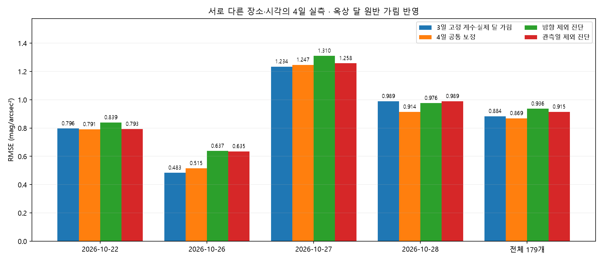
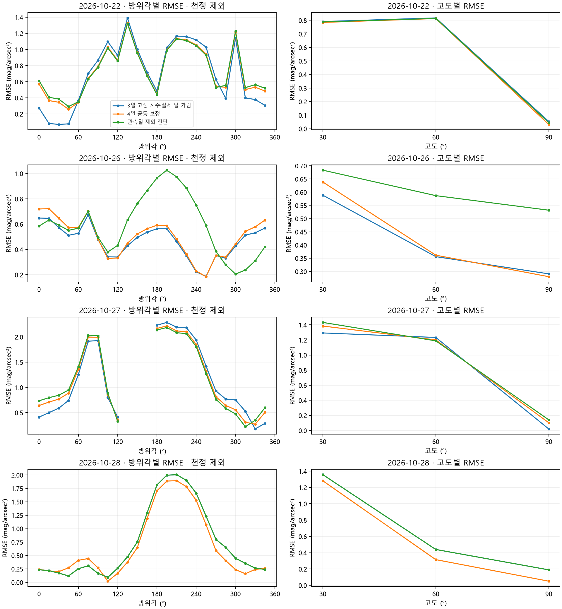

# 2026-10-28 · 옥상 관측 추가와 4일 공통 연구 모델

**22일 49개 + 26일 49개 + 27일 33개 + 28일 48개 = 유효 179개.** 원본은 총 196칸이며 기존 27일 결측 16칸과 새 28일 결측 1칸만 제외했다. 다른 이상치 제거·SQM 보간은 없다. 앱 0.9.3·legacy는 유지하며 연구 모델만 갱신했다.

## 장소와 시간

| 날짜(KST) | 장소·좌표 | 시간 입력 |
| --- | --- | --- |
| 10월 22일 | 33.426769, 126.530349 | 30° 21:25, 60°·천정 22:15, 기존 구간 대표값 |
| 10월 26일 | 탐라교육원 운동장 중앙 근사 33.42785, 126.53208 | 18:32, 기존 18:29–18:35 대표값·황혼 |
| 10월 27일 | 과학고 북쪽 지상 핀 33.426633, 126.530639 | 21:10, 기존 21:08–21:13 대표값 |
| 10월 28일 | 과학고 서쪽 건물 옥상 사진 핀 근사 **33.42642, 126.53016** | **21:13~21:23의 11개 분을 각각 계산** |

28일의 빈 시간칸은 바로 위의 명시된 분을 이어받는다는 사용자 확인을 반영했다. 각 분의 00초는 대표시각이며 실제 측정 초를 알고 있는 것은 아니다. 시간 사이 전달장 보간 없이 11개 시각 각각 맑음·흐림(광학 두께 1/10/30)의 총 44개 전달장을 풀었다. 모든 상태의 수렴 진단을 [contexts.json](basis/rooftop_native/contexts.json)에 저장했다.

[원본 표](../../datasets/2026-10-28_2113-2123_KST_jeju_science_rooftop/raw/sqm_observations.csv) · [원본 지도 사진](../../datasets/2026-10-28_2113-2123_KST_jeju_science_rooftop/raw/location_reference_user.png) · [지도 대조 화면](../../datasets/2026-10-28_2113-2123_KST_jeju_science_rooftop/raw/location_registration_map.png) · [확인된 조건](../../datasets/2026-10-28_2113-2123_KST_jeju_science_rooftop/raw/confirmed_conditions_v001.json). 초기 원본 메타데이터의 좌표 미정 상태는 보존하고, 확정한 근사 좌표를 별도 조건 파일에 추가했다. GPS 측량값이 아니며 위치 오차 최소 10 m를 가정한다.

4층 높이라는 정보는 기록했다. 정확한 미터값·기준면이 없고 Copernicus 자료는 구조물이 섞일 수 있는 DSM이므로 임의의 12 m를 더하지 않았다. 기존 지면 기준 RTE 격자를 유지하며 **센서 높이와 건물의 3차원 형상을 해상하여 푼 것은 아니다.**

## API 입력

28일에는 **새 옥상 근사 좌표로 세 패키지를 새로 조회**해 원본 JSON과 수신 영수증을 저장했다. 수신시각은 **2026-10-28 21:57 KST**다. `airquality-3h`, `clouds-3h`, `air-3h`의 원자료는 3시간 간격이고, 해당 날짜 21:00–다음날 00:00 자료를 각 측정 분에 보간했다. 각 보간 끝점과 비율을 저장했다. [API JSON](../../datasets/2026-10-28_2113-2123_KST_jeju_science_rooftop/raw/weather_cache_33.42642_126.53016_2026-10-28.json) · [수신 기록](../../datasets/2026-10-28_2113-2123_KST_jeju_science_rooftop/raw/weather_cache_33.42642_126.53016_2026-10-28.receipt.json). 키는 저장·게시하지 않는다.

22·26·27일의 위치·시간·원래 API·131개 전달장은 그대로 재사용했다. 이전 세 날짜 예측과의 차이는 **0 mag**다. 측정 이후 받은 기상 모델 출력이므로 실측 기상이나 실시간 예보 성능으로 해석하지 않는다. 구름 밑면의 유효 기압이 없을 때 2 km를 가정한 상태도 명시했다.

## 먼저 수행한 28일 고정 계수 평가

직전 `joint-sos3d-twilight-2026.10.28`의 계수를 고정하고 새 48개를 계산한 뒤에만 공동 보정을 시작했다.

| 28일 조건 | MSE | RMSE |
| --- | ---: | ---: |
| 달이 가려지지 않은 반사실적 대조 | 1.049104 | 1.024258 |
| 사용자 확인대로 달 원반 직접광만 차단 | 0.978759 | 0.989322 |

[고정 평가 보고서](frozen_oct28_report.json) · [고정 평가 전용 실행](../../datasets/2026-10-28_2113-2123_KST_jeju_science_rooftop/001_frozen_three_day/README.md). 이는 새 데이터로 계수를 맞추기 전의 검사다. 지붕 조건을 입력하는 측정 모형은 이번에 추가했고 API는 관측 뒤 받은 값이므로, 완전히 사전 등록된 실시간 미래 예측 실험으로 부르지 않는다.

## 달 가림을 반영한 방법

사용자가 21:13–21:23 내내 달 원반이 지붕에 가렸다고 확인했다. 그래서 로컬 달 원반 가시율을 28일에만 **0으로 고정**했다. 다른 날은 기존 조건 1을 유지했다. 이 값은 SQM에 맞춰 최적화한 달 감쇠 계수가 아니다.

센서에서 보는 조건부 복사휘도에 `L = L_art + L_bg + L_moon_diffuse + visibility*L_moon_direct`를 적용한 뒤 SQM으로 변환한다. **대기에서 산란한 달빛과 그 다중산란은 남는다.** 지붕 때문에 달 광원이 대기 전체에서 사라졌다고 처리하지 않는다. [Jones et al.(2013)](https://doi.org/10.1051/0004-6361/201322433)은 대기 산란 달빛 모형의 참고 문헌이며, 이 옥상의 국소 원반 가림은 기하학적 추론이다. SQM-L FWHM 20°는 [제조사 자료](https://www.unihedron.com/projects/sqm-l/Instruction_sheet.pdf)를 따른 Gaussian 근사이며 실제 날개 응답·지붕 각도별 차폐·주변 반사광을 측정한 것은 아니다.

## 네 날짜 공동 보정 결과

| 날짜 | n | 직전 고정 계수 RMSE¹ | 새 공동 MSE | 새 공동 RMSE | 방향 제외 RMSE | 관측일 제외 RMSE |
| --- | ---: | ---: | ---: | ---: | ---: | ---: |
| 2026-10-22 | 49 | 0.79613 | 0.62505 | 0.79060 | 0.83910 | 0.79266 |
| 2026-10-26 | 49 | 0.48326 | 0.26535 | 0.51512 | 0.63743 | 0.63498 |
| 2026-10-27 | 33 | 1.23432 | 1.55472 | 1.24688 | 1.31049 | 1.25751 |
| 2026-10-28 | 48 | 0.98932 | 0.83570 | 0.91417 | 0.97622 | 0.98932 |
| 전체 | 179 | 0.88361 | 0.75446 | 0.86860 | 0.93602 | 0.91453 |

¹ 28일에는 실제 원반 가림 조건을 적용했다. 22·26·27일의 직전 고정 결과는 그대로다. MSE 단위는 (mag/arcsec²)², RMSE는 mag/arcsec²다. 전체 행은 179점 통합 오차이며 최적화 목적함수는 관측일별 동일 가중치다.

공통 계수는 `{"art_scale": 0.3548913200550485, "twilight_gain": 1.481668301347112, "twilight_concentration": 1.3230622918214614, "cloud_optical_depth": 10.0}`다. 위성광 유효 광원 세기와 황혼 gain·방향 모양만 공유해 보정하고, 구름 광학 두께는 훈련 자료에서만 1/10/30 중 선택한다. 날짜·장소별 자유 오프셋이나 새 다중산란 상수 배수는 없다. 기존 공간·방향·차수별 다중산란, KS91 달 위상, 유한 원반, 실제 각도 첫 산란, 황혼 prior는 그대로다.

전체 179점의 RMSE는 고정 계수 **0.88361 → 0.86860**으로 감소했다. 26일은 **0.48326 → 0.51512**, 27일은 **1.23432 → 1.24688**로 증가했다. 28일 남남서 방향의 큰 잔차도 남아 있다. [고도별 오차·최대 잔차](residual_diagnostics.json)에 수치와 방향을 저장했다. 달은 측정 시작에 동북동쪽 방위각 약 73.25°·고도 23.13°였으므로 남쪽 밝기의 원인을 달 직접광으로 단정하지 않는다. 근거리 조명·구름의 공간 분포·지붕에 가린 빔 날개 등은 추가 관측이 필요한 가설이다.

관측일 제외 검사는 매번 한 날짜 전체를 빼고 나머지 날짜로 계수·광학 두께를 다시 선택한 뒤 빠진 날짜를 예측한다. 방향 제외 검사는 60° 방위각 구역을 네 날짜에서 함께 제외하고 천정을 별도 분할로 둔다. 모든 점이 한 번씩 평가됐고 훈련·검사 식별자를 저장했다. 28일 제외 결과는 직전 세 날짜 고정 계수 예측과 일치한다. 26일을 빼면 황혼을 학습할 날이 없어 gain=1·concentration=1의 선언된 prior를 사용한다.

공동 보정 오차는 학습 오차이고 분할 결과는 사후 진단이다. 네 날짜만으로 계수의 일반화나 날씨별 인과 효과가 입증된 것은 아니다. 운량 확률의 맑음/흐림 혼합, 가정한 광학 두께, 미확인 국소 광원과 지붕 시야는 남은 제약이다. 높은 잔차도 숨기지 않고 모든 방향을 보존했다.

## 검증과 재현

기존 검사와 새 달 가림·결측·시간·검사값 누수 검사를 합쳐 **106개 통과**했다. SQM 정답을 받지 않는 `RoofSkyModel.predict`를 native 전달장으로 다시 실행해 저장 예측과 일치하고, 가시율 1은 이전 `JointSkyModel`과 일치함을 확인했다. [검증 기록](validation.json) · [추론 검사](inference_verification.json) · [전체 수치·제약](report.json) · [179개 입력과 예측](input_and_predictions.csv).

새 인공광 계수를 실제 광원 입력에 적용하고 직접 달 원반 플래그를 끈 전달장을 다시 풀어 선형 결합 예측과 일치하는 것도 확인했다. 산란 차수의 마지막 항 수렴은 현재 격자에서의 수치 기준이며 전체 오차 상한이나 실제 하늘 정확도의 보증은 아니다.

모델·연구 코드·기존 물리 코드를 [소스 스냅샷](../../models/joint-sos3d-roofmask-2026.10.28/manifest.json)에 해시와 함께 보관했다. 전체 저장소와 이전 기상 어댑터, 별도 위성 H5·DEM이 재현에 필요하다. 앱 소스·기본값·빌드·릴리스·배포는 변경하지 않았다.
