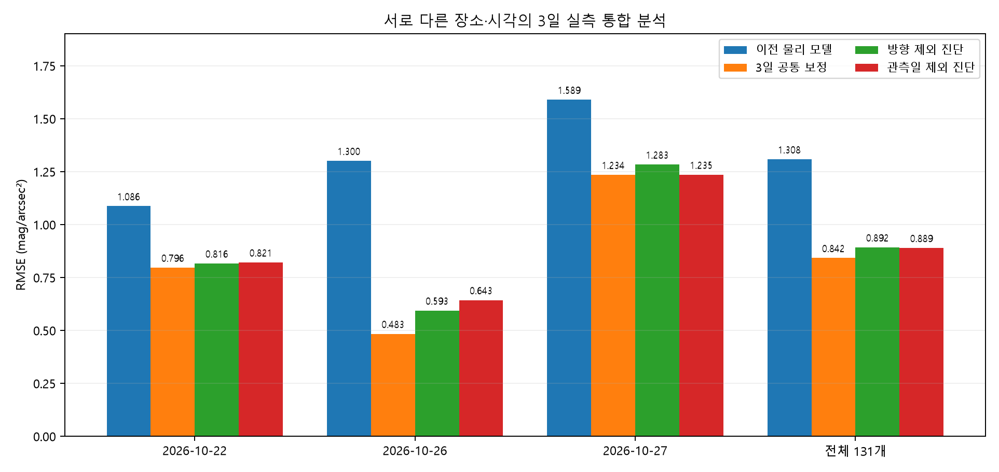
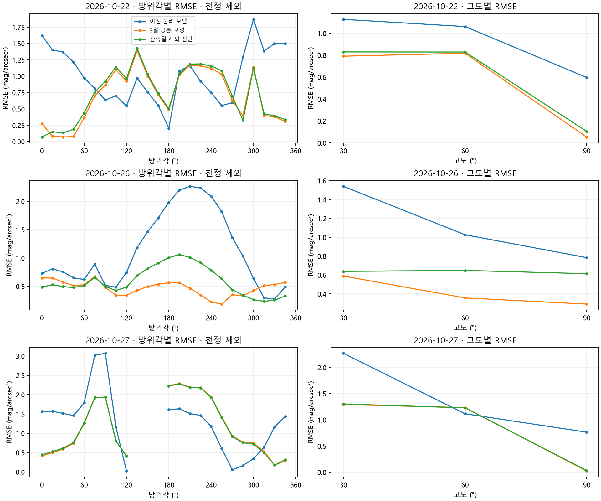

# 2026-10-28 · 세 날짜 공통 연구 모델

**22일 49개 + 26일 49개 + 27일 유효 33개 = 131개를 모두 공통 보정에 사용했다. 앱은 미적용이며 공개 0.9.3·legacy를 유지한다.** 원본 147칸 중 27일 결측 16칸만 기존 기준대로 평가에서 제외했다. 새 이상치·달 접근·차폐 제외는 없다.

| 관측일(KST) | 위치 | 시각 처리 |
| --- | --- | --- |
| 10월 22일 | 33.426769, 126.530349 | 고도 30° 21:23~21:28 → 21:25, 60°·천정 22:12~22:18 → 22:15 |
| 10월 26일 | 탐라교육원 운동장 중앙 근사 33.42785, 126.53208 | 18:29~18:35 → 18:32 |
| 10월 27일 | 제주과학고 북쪽 지도 핀 33.426633, 126.530639 | 21:08~21:13 → 21:10 |

장소·시각·기상·DEM 표고·광원 지형을 날짜별로 따로 계산했다. 22일 두 관측 구간도 나눴다. 개별 측정 시각은 없으며 기존 대표 시각을 유지했다. 원본과 API의 해시·모든 보간 끝점·구름 밑면 가정은 [입력 근거](basis/representative/provenance.json)와 [환경](basis/representative/contexts.json)에 있다. 새 유료 API 조회는 없다.

## 결과

| 날짜 | n | 이전 물리 모델 RMSE | 공통 보정 MSE | 공통 보정 RMSE | 방향 제외 RMSE | 관측일 제외 RMSE |
| --- | ---: | ---: | ---: | ---: | ---: | ---: |
| 2026-10-22 | 49 | 1.08638 | 0.63382 | 0.79613 | 0.81595 | 0.82079 |
| 2026-10-26 | 49 | 1.30048 | 0.23354 | 0.48326 | 0.59344 | 0.64272 |
| 2026-10-27 | 33 | 1.58930 | 1.52355 | 1.23432 | 1.28323 | 1.23496 |
| 전체 | 131 | 1.30780 | 0.70823 | 0.84156 | 0.89195 | 0.88921 |

이전 물리 모델은 같은 131개에 대한 `sos3d`·SQM-L·기본 광학 두께 10의 미보정 결과이며 황혼 항이 없다. 앱 legacy 결과와 새 모형의 미보정 prior·같은 계수의 복사휘도 평균 방식도 [report.json](report.json)에 함께 저장했다. RMSE 단위는 mag/arcsec², MSE는 그 제곱이다.

## 실제 모델 변경

기존 방향·공간·차수별 복사전달, 달 원반과 직접광·SQM-L 20° 응답은 유지했다. 다중산란 상수 배수를 추가하거나 달을 끄지 않았다. `art_scale`은 위성광의 유효 광원 세기에만 작용한다. native 전달장을 이 계수로 다시 풀어 선형 결합과 일치함을 [확인](inference_verification.json)했다.

1. 각 위치·시각의 맑음/흐림 조건부 전달장과 API 운량 확률 C를 보존한다. SQM의 제곱 오차를 줄이는 점 예측은 `(1-C)*SQM(clear)+C*SQM(cloudy)`다. 기존 `SQM((1-C)*Lclear+C*Lcloud)`도 분리 출력해 비교했다. 둘은 로그 변환 때문에 다르다. 이는 실제 구름 영상 없이 가정한 두 상태 분포이며 차폐를 관측한 것으로 해석하지 않는다.
2. [Patat·Ugolnikov·Postylyakov(2006), Table 1](https://arxiv.org/html/astro-ph/0604128)의 V-band 천정식 `m=11.84+1.518*(ζ-95)-0.057*(ζ-95)²`를 황혼 밝기의 prior로 사용한다. 연구 배경광 22 mag에 해당하는 휘도를 빼 중복 합산을 줄인다. 검증된 문헌 범위는 태양 고도 −15°~−5°다. 밤(≤−18°)은 황혼 항 0, 나머지 범위는 오류로 명시하며 임의 외삽하지 않는다.
3. 황혼의 방향 확장은 이번 연구의 경험식이다. `csc(고도)*exp(k*(cos(태양각거리)-sin(태양고도)))`를 SQM-L 시야에서 적분한다. 천정 기준으로 정규화하고 1° 아래 secant를 제한하며 지평선 아래 광선은 0으로 둔다. 이 항은 구면 태양 복사전달 계산이 아니다.
4. 3일 공통 계수는 광원 배율 **0.19245975**, 황혼 prior 배율 **1.59705864**, 방향 집중도 **1.26441850**다. 광학 두께는 사전 정의한 1/10/30 중 훈련 자료에서 **10**을 선택했다. 구름 미세물리를 실측·역산한 값으로 주장하지 않는다. 날짜·장소별 자유 오프셋은 없다.

## 보정과 검증 구분

전체 보정은 날짜마다 같은 가중치로 SQM 제곱 잔차를 최소화했다. 27일의 유효 개수가 적다고 그 날짜를 덜 중요하게 두지 않는다. 표의 전체 MSE/RMSE는 일반적인 131행 합산값이므로 최적화 목적값의 날짜 평균과 구분한다.

- 방향 제외: 60° 방위 구간 6개와 천정 1개를 모든 날짜에서 함께 제외했다. 매 분할에서 계수와 광학 두께를 훈련 데이터만으로 다시 선택했다.
- 관측일 제외: 날짜 하나 전체를 빼고 나머지 날짜로만 보정·광학 두께를 선택했다. 대상 실측값은 최적화 목적함수에 접근하지 않는다.
- **26일 제외 시 나머지는 전부 밤이므로 황혼 계수를 학습할 수 없다.** 이때 gain=1, 집중도=1의 선언된 prior를 사용했다. 26일의 0.64272는 이 prior 예측 진단이며 황혼의 독립 재보정 검증이라고 부르지 않는다.
- 세 날짜를 이미 구조 개발에 참고했으므로 모두 사후 진단이다. 독립적인 미래 날짜 검증은 아니다. 인접 15° 관측은 상관되어 있고 날짜·장소·기상이 함께 달라져 효과를 독립적으로 분리할 수 없다.
- 27일은 여전히 오차가 가장 크고, 달 주변과 남쪽 방향의 차이가 남는다. 어떤 관측도 회전·보간·삭제하지 않았고 달 밝기 감쇠 계수를 맞추지 않았다.

## 시각 불확실성과 재현

전체 자료를 각자 구간의 시작/끝에 둔 시나리오를 동일 계수로 재계산했다. [시간 범위 수치](time_interval_sensitivity.json)·[예측표](time_interval_predictions.csv)와 날짜별 `time_range.png`를 따른다. 실제 스캔 시각이나 신뢰구간이 아니다. 특히 한 번의 황혼 스캔만으로 실제 시간 변화율·스캔 순서 효과를 분리할 수 없다.

[모델·계수 스냅샷](../../models/joint-sos3d-twilight-2026.10.28/manifest.json) · [반복 계산 검사](inference_verification.json) · [전체 예측](input_and_predictions.csv). 연구 `joint_model.JointSkyModel.from_artifact(candidate_params.json)`로 관측 SQM을 입력하지 않고 위치·방향·한국시간·동일 장소 API·광원/DEM에서 계산할 수 있다.

저장소 루트에서 `PYTHONPATH=backend/src`를 지정하고 `prepare_joint_basis.py --h5 <H5> --dem <DEM> --output <새폴더>`, `joint_three_dates.py --basis <새폴더> --output <새결과폴더>`로 재현한다. 두 스크립트는 이 연구 폴더에 있다. 대용량 원자료·키는 저장소에 포함하지 않는다. Python/라이브러리 버전·실제 소스 해시는 보고서에 고정했다. 102개 테스트와 라벨 없는 추론·native 광원 선형성 검사를 통과했다.

26일의 시각 민감도: 모든 방향을 18:29로 두면 RMSE 0.69025, 18:35로 두면 0.64051이다. 대표 시각 18:32 결과와의 개별 예측 차이는 최대 0.60507 mag다. 실제 방향별 시각이 없으므로 이를 이용해 시각을 골라 보정하지 않았다.
